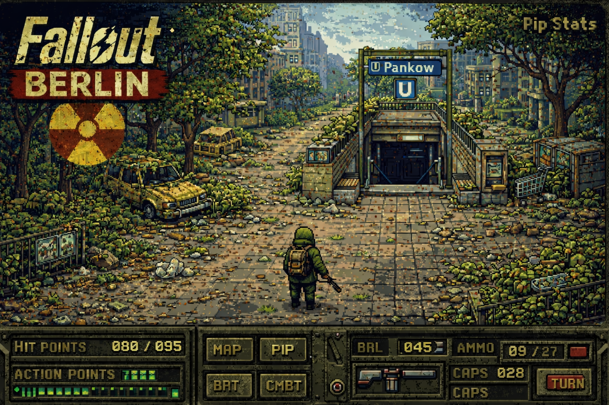

# Fallout: Berlin - Text-Based Adventure
<p align="center">
  
</p>

> "Berlin was broken before the bombs fell — and reshaped by them afterward."

Welcome to **Fallout: Berlin**, a narrative-driven RPG set in the year 2287. While the Commonwealth struggles in the remains of Boston, the citizens of Berlin navigate a city divided by more than just walls.

---

## 🌍 The World: Berlin, the Ash City

Berlin is no longer a city of light; it is a **City of Layers**. 

### 🏙️ The Surface - "The Ash City"
Navigate the ruins of iconic landmarks. Scavenge the **Mitte Ruins**, trade at the neutral ground of **Checkpoint Charlie**, or risk your life near the **Brandenburg Gate**, now a grim raider fortress. The **Fernsehturm (TV Tower)** glows with an eerie green light, serving as a beacon for those brave enough to climb its collapsed structure.

### 🚇 The Underground - "Die Tiefe"
When the radstorms roll off the Spree River, the only safety is found in **Die Tiefe**. Explore a claustrophobic network of U-Bahn tunnels, WWII bunkers, and forgotten Stasi facilities. But stay alert—feral "Stasi Ghosts" and the mysterious **Schattenvolk** ghouls claim the darkness as their own.

### 🌲 The Reclaimed Zones
The **Tiergarten** is no longer a park; it's a dense, mutated forest where **Radhunde** (mutated German Shepherds) hunt in packs. In the distance, the **Feld Commune** has turned Tempelhofer Feld into a massive communal settlement, a rare spark of hope in the wasteland.

---

## ⚔️ Factions of the Kiez
*   **The Iron Ring (Eisenring):** Based in the Reichstag, they seek order through surveillance and engineering supremacy. Look for their blocky Power Armor and red eagle insignias.
*   **The Feld Commune:** Anti-tech collectivists holding Tempelhofer Feld. They fight with pipe weapons and a fierce sense of equality.
*   **The Werkbund:** Pragmatic traders and scavengers centered around Potsdamer Platz. They are the gears that keep the wasteland economy turning.
*   **The Schattenvolk:** A secretive ghoul network trading information from the depths of the city.

---

## 🛠️ Features
- **Dynamic Character Creation**: Choose from unique origins like **Späti Mogul**, **Siemens Technician**, or **U-Bahn Raider**.
- **Tactical Combat**: Experience visceral combat with critical misses, V.A.T.S.-inspired hits, and damage resistance that actually matters.
- **Crafting System**: Scavenge for junk to build **Molotov Cocktails** or repair your gear.
- **Environmental Hazards**: Manage your **Radiation** levels as you travel through radioactive hotspots like Alexanderplatz.
- **Atmospheric HUD**: A Pip-Boy inspired text interface with visual HP/RAD bars and location-specific tags.

---

## 🚀 Getting Started

### Installation
No external dependencies! Requires only **Python 3.10+**.

### Running the Game
Simply run the launcher from the root directory:
```bash
python run_game.py
```

---

## 🎮 Game Commands
- **Movement**: `go north`, `s`, `east`, `w`
- **Scavenging**: `look`, `take [item]`, `look [target]`
- **Survival**: `inventory`, `use [item]`, `equip [weapon/armor]`
- **Interaction**: `talk [npc]`, `craft [recipe]`
- **Management**: `stats`, `save`, `load`, `quit`

---

## 📂 Project Structure
*   **`run_game.py`**: The game launcher.
*   **`fallout_berlin/`**: Core game package.
    *   **`data/`**: JSON databases for items, enemies, and locations.
    *   **`game_engine.py`**: The heart of the game loop and UI.
*   **`docs/`**: Worldbuilding lore and technical documentation.

---

*"Fallout: Berlin — where history never stays buried."*

